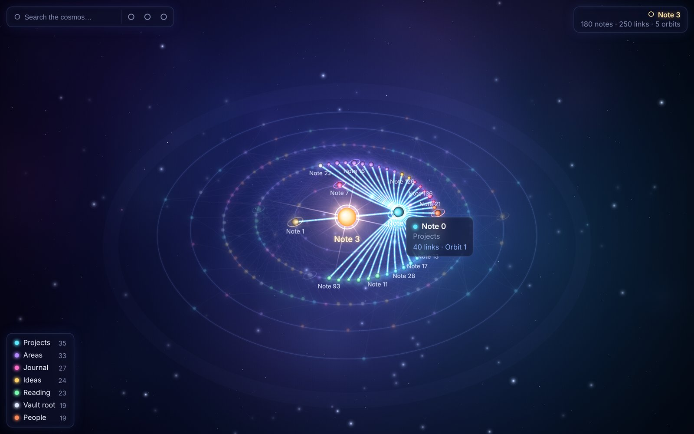
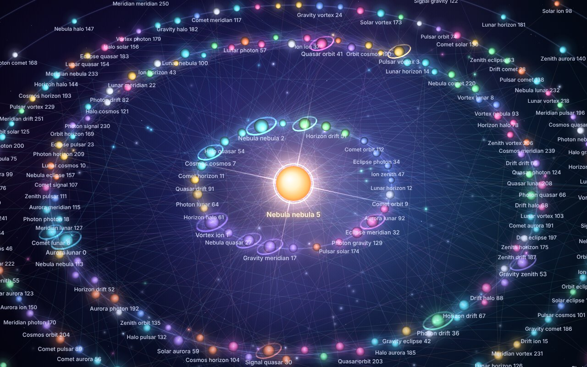

# Orbit Graph for Obsidian

See your vault as a glowing solar system. The note you have open becomes the **sun**,
the notes it links to orbit closest to it, notes two links away orbit further out,
and so on. Notes that aren't connected at all drift in an outer **asteroid belt**.





## Features

- **Orbits by link distance.** Each ring is one more link away from the sun. Inner orbits move faster than outer ones, the way real orbits do.
- **Planets that tell you something.** Size = number of links. Color = top-level folder. Well-linked notes (8+ links) get Saturn-style rings. Planets are lit from the sun's side.
- **Glow everywhere.** Additive-blended halos, a pulsing sun with lens flares, a nebula backdrop, twinkling parallax stars, and the occasional shooting star.
- **Signals.** Little pulses of light travel along your links.
- **Smooth travel.** Open a note and it flies into the center while everything else glides to its new orbit.
- **Explore.** Hover a planet to light up its connections. Search to highlight matches. Click a folder in the legend to isolate it.
- **3D-ish camera.** The orbit plane is tilted with perspective, so near planets look bigger. Shift-drag to change the tilt.

## Controls

| Action | What it does |
| --- | --- |
| Click a planet | Open the note (it becomes the sun if "Center" is set to the open note) |
| Ctrl/Cmd-click | Open the note in a new tab |
| Ctrl/Cmd-hover | Page preview |
| Right-click a planet | Menu: open, open in new tab, **make this the sun** |
| Drag | Pan |
| Shift-drag (or middle-drag) | Tilt the camera |
| Scroll | Zoom toward the cursor |
| Double-click empty space | Fit everything in view |
| Search box + Enter | Highlight matches; Enter makes the best match the sun |

Commands: **Open orbit graph** and **Open orbit graph in sidebar**. There's also an orbit icon in the ribbon.

Tip: put the orbit graph in a split pane or in the sidebar next to your editor. Then clicking planets moves you around your vault while you watch the system rearrange.

## Settings

Center (the open note or your most-linked note), number of orbits, unlinked notes on/off, excluded folders, orbit speed (0 = frozen), camera tilt, orbit paths, links, link brightness, signals, glow intensity, star density, and the planet size at which labels appear.

## Installation

### Manual

1. Build it (see below), or download `main.js`, `manifest.json` and `styles.css` from a GitHub release.
2. Copy those three files into `<your vault>/.obsidian/plugins/orbit-graph/`.
3. In Obsidian, go to **Settings → Community plugins**, reload the list, and turn on **Orbit Graph**.

### With BRAT

Add this repository in the [BRAT](https://github.com/TfTHacker/obsidian42-brat) plugin. You need a GitHub release first: push a tag such as `1.0.0` and the included workflow builds and attaches the files.

## Development

```bash
npm install
npm run dev     # rebuilds main.js on change
npm run build   # type-check and build a minified main.js
npm run demo    # build a standalone browser demo with a fake vault
```

`npm run demo` writes `demo/dist/demo.js`. Open `demo/index.html` in a browser to work on the
renderer without Obsidian. Add `?n=800` to the URL to try a bigger fake vault.

Code layout:

- `src/graph.ts`: builds the link graph and assigns notes to orbits (no Obsidian dependency)
- `src/renderer.ts`: the canvas renderer: camera, animation, glow, hit-testing (no Obsidian dependency)
- `src/view.ts`: the Obsidian view: vault data, toolbar, legend, tooltip, opening notes
- `src/settings.ts`, `src/types.ts`: settings tab and defaults
